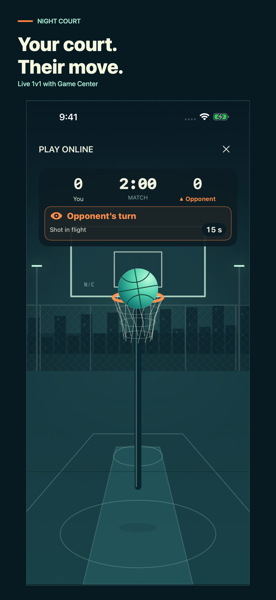

# Night Court 1.2 — press kit

Night Court: Basketball Arcade brings a street basketball court to iPhone and iPad. Version 1.2 adds live one-on-one play through Game Center alongside offline Arcade and Practice, recurring streak leaderboards, and six permanent achievement badges.

Planned publication window: **November 4–11, 2026**, subject to App Review approval. This is a planned update, not an announcement that version 1.2 is already available.

[Download the complete marketing kit](https://raw.githubusercontent.com/mdo91/night-court-support/main/press-kit/1.2/night-court-1.2-press-kit.zip)

## Live one-on-one play

Find an opponent using Game Center matchmaking or invite a Game Center friend. Both players watch each shot live, while only the active player shoots. Matches last 120 seconds, with 15-second possessions including ball flight. Makes retain possession, misses pass the turn, baskets score two points and swishes three, and ties are draws. Clear turn indicators and refreshed swish celebrations make each possession easy to follow. Online play requires internet access and permitted Game Center multiplayer access.

## Offline progression

Practice without a time limit or play 60-second Arcade rounds. Completed basket streaks compete on daily, weekly and repeating 30-day Game Center boards. Three badges recognize streaks of 10, 50 and 100 consecutive baskets; three recognize confirmed global ranks of first, second and third. Online scores do not contribute to offline records, leaderboards or badge progress. The game has no ads or in-app purchases.

## Screenshots and artwork

All six screenshots show the current app interface. Online captures use isolated sample players; badge captures show locked achievements and their actual unlock requirements. Brand artwork combines the original court and basketball illustrations with the NIGHT COURT wordmark.

- [iPhone: live 1v1 match](iphone-online-play.png) — both scores, the shared timer, turn indicator and an opponent shot.
- [iPad: live 1v1 match](ipad-online-play.png) — the same online experience adapted to the larger court.
- [iPhone: streak badges](iphone-streak-badges.png) / [iPad: streak badges](ipad-streak-badges.png) — 10, 50 and 100 consecutive baskets.
- [iPhone: placement badges](iphone-placement-badges.png) / [iPad: placement badges](ipad-placement-badges.png) — verified global ranks 1, 2 and 3.
- [Header artwork](header.png) — 5244 × 2950.
- [Search artwork](search.png) — 1920 × 1280.
- [App icon](app-icon.png) — 1024 × 1024.

## Platform and language details

Requires iOS/iPadOS 17 or later. Available in English, French, German, Japanese, Korean, Russian and Turkish. Sound and haptics have separate switches; the game follows the system Reduce Motion setting. Offline modes can be played without signing in.

[Game support](https://mdo91.github.io/night-court-support/) · [Privacy policy](https://mdo91.github.io/night-court-support/privacypolicy.html)

These materials are provided for editorial coverage of Night Court. © 2026 Mahmut Aoata.
